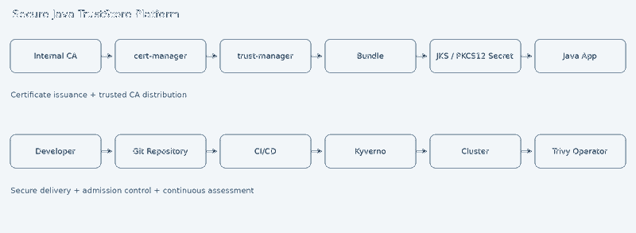
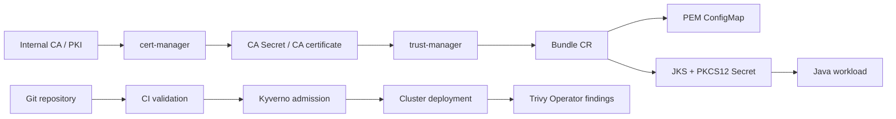

# Secure Java TrustStore Platform

[](.github/workflows/validate.yml) [](LICENSE)

**Reference architecture for secure Java CA trust distribution on Kubernetes and OpenShift.** Combines cert-manager for certificate issuance/renewal, trust-manager for CA bundle aggregation and JKS/PKCS12 generation, Kyverno for admission controls, and Trivy Operator for continuous security findings.

> **Reference implementation, not a turnkey production PKI.** Review operator versions, CRDs, CA ownership, registry/signature identities, namespace scoping, secret encryption and RBAC against your cluster. The bootstrap CA and sample passwords are **lab-only**. No real CA private keys or credentials belong in Git.



## Features

- CA certificate Secret ingestion and trust-manager namespace-scoped distribution
- PEM, Java JKS and PKCS12 truststore targets; **Secret** targets for password-bearing artifacts
- cert-manager CA-issued server certificate with automated renewal and optional trust source via CA Secret
- Non-root Java container mounting a generated JKS Secret read-only
- Kyverno examples for non-root, limits, no privilege escalation, signed images, required truststore, allowed registries, metadata and security contexts
- Trivy Operator Helm values, vulnerability/configuration reports and operational queries
- OpenShift `restricted-v2`-friendly sample (arbitrary UID, no fixed UID, drop ALL capabilities, seccomp)
- Verification/import scripts, GitHub CI, architectural documentation and contribution guidance

## Architecture



**Important:** A cert-manager `Certificate` generally creates a *leaf TLS Secret*. The `ca.crt` field is not a guaranteed complete trust chain, and blindly trusting issued leaf certificates is incorrect. For trust-manager, prefer a separately governed CA certificate Secret (or a vetted `ca.crt` from an issuer you control). trust-manager reads source Secrets only when explicitly enabled; restrict its source access.

## Prerequisites

- Kubernetes/OpenShift cluster with cluster-admin/operator installation rights
- `kubectl` or `oc`, `helm`, `openssl`, `keytool` (JDK 17+), `bash`, optional `yq`
- cert-manager, trust-manager, Kyverno, Trivy Operator versions compatible with your Kubernetes release
- Dedicated `trust-system` source namespace and labeled application namespaces
- Container image mirrored into an approved registry and signed with Cosign for enforcement

## Installation (lab walkthrough)

1. Install operators using supported Helm charts or OpenShift Operators; see [docs](docs/architecture.md). Install **cert-manager before trust-manager**. In production pin chart versions and review permissions.
2. Create namespaces and source CA (lab-only):

   ```bash
   kubectl apply -f examples/cert-manager/namespaces.yaml
   # Lab ONLY: generates a local self-signed CA; never commit ca.key.
   ./scripts/create-lab-ca.sh
   kubectl apply -f examples/cert-manager/issuer.yaml
   kubectl apply -f examples/cert-manager/certificate.yaml
   ```
3. Configure trust-manager installation with `secretTargets.enabled=true`, the appropriate trust namespace and Secret source restrictions for your chart version; see [trust-manager docs](docs/trust-manager.md). **The Helm value names/behavior must be verified against your installed release.**
4. Provision password Secret in `trust-system` using an external secret provider; for local tests only: `kubectl -n trust-system create secret generic truststore-password --from-literal=password=changeit`.
5. Apply `kubectl apply -f examples/trust-manager/bundle.yaml` and `kubectl apply -f examples/trust-manager/bundle-java.yaml`. Confirm the Bundle status and targets exist in labeled namespaces.
6. Build, push, scan and sign the Java image, update `IMAGE_REPLACE_ME` in `examples/java-app/deployment.yaml`, then apply it. Do **not** deploy the placeholder image.
7. Install Kyverno policies **after** adapting registry, Cosign key/identity and workload labels; apply `examples/kyverno/` deliberately. Begin with audit mode for rollout.
8. Install Trivy Operator with `examples/trivy/values.yaml` and review its findings.

## Usage and verification

```bash
kubectl get certificates,certificaterequests -n trust-system
kubectl get bundles.trust.cert-manager.io
kubectl -n demo-java get configmap enterprise-ca-pem
kubectl -n demo-java get secret enterprise-java-truststores
kubectl -n demo-java get secret enterprise-java-truststores -o jsonpath='{.data.truststore\.jks}' | base64 -d > /tmp/truststore.jks
TRUSTSTORE_PASSWORD=changeit ./scripts/verify-jks.sh /tmp/truststore.jks
kubectl -n demo-java get deploy java-tls-demo
kubectl get vulnerabilityreports.aquasecurity.github.io -A
kubectl get configauditreports.aquasecurity.github.io -A
```

Never expose production truststore passwords in shell history. Use temporary protected files and injected environment variables or a secret manager.

## Security architecture

| Layer | Control | Purpose |
|---|---|---|
| CA source | CA Secret with least-privilege access | Limit trust anchor modification |
| Issuance | cert-manager Issuer/Certificate | Automate leaf certificate lifecycle |
| Trust distribution | trust-manager Bundle, namespace selector | Consistent trusted CA propagation |
| Truststore | Secret targets, separate password Secret | Protect binary store/password; avoid broad ConfigMap exposure |
| Admission | Kyverno | Block noncompliant deployments |
| Runtime posture | OpenShift SCC / Pod Security | Constrain privileges and execution |
| Detection | Trivy Operator | Continuous image/configuration vulnerability visibility |
| Supply chain | signed digest-pinned image + CI | Artifact provenance and integrity |

## Example workflows

**CA rotation:** add new CA to source Secret → Bundle reconciles → workloads receive updated projected Secret volume → restart/reload JVMs (many JVMs cache trust managers) → verify new CA → remove old CA after overlap. Coordinate trust and certificate rollovers; updating files does **not** guarantee live JVM reload.

**Renewal:** cert-manager renews the application leaf certificate before expiration; a truststore need not change when the issuing CA remains unchanged. CA root rotation is a separate, controlled process.

**Deployment:** pull request → lint/manifest validation → build and scan → sign/push digest → Kyverno admission verification → deployment → Trivy Operator reports.

## Troubleshooting

See [troubleshooting](docs/troubleshooting.md) for empty Bundles, missing Secret targets, OpenShift SCC denials, truststore password mismatch, TLS path validation and stale JVM trust managers.

## Future enhancements

- External Secrets Operator / Vault / cloud KMS integration
- Automated certificate expiry alerts and truststore rotation rollout controllers
- Prometheus metrics and Grafana dashboard for PKI and Trivy reports
- SLSA attestations, SBOM signing, admission verification of attestations
- GitOps overlays for AKS/EKS/OpenShift with integration tests

## Documentation

[Architecture](docs/architecture.md) · [cert-manager](docs/cert-manager.md) · [trust-manager](docs/trust-manager.md) · [Kyverno](docs/kyverno.md) · [Trivy](docs/trivy.md) · [Troubleshooting](docs/troubleshooting.md) · [Security practices](docs/security-best-practices.md)

## Contributing / releases / license

See [CONTRIBUTING.md](CONTRIBUTING.md), [SECURITY.md](SECURITY.md), [RELEASING.md](RELEASING.md). Licensed under [Apache-2.0](LICENSE).

## References

- https://cert-manager.io/docs/
- https://cert-manager.io/docs/trust/trust-manager/
- https://kyverno.io/docs/
- https://aquasecurity.github.io/trivy-operator/
- https://docs.redhat.com/en/documentation/openshift_container_platform/
- https://kubernetes.io/docs/concepts/security/