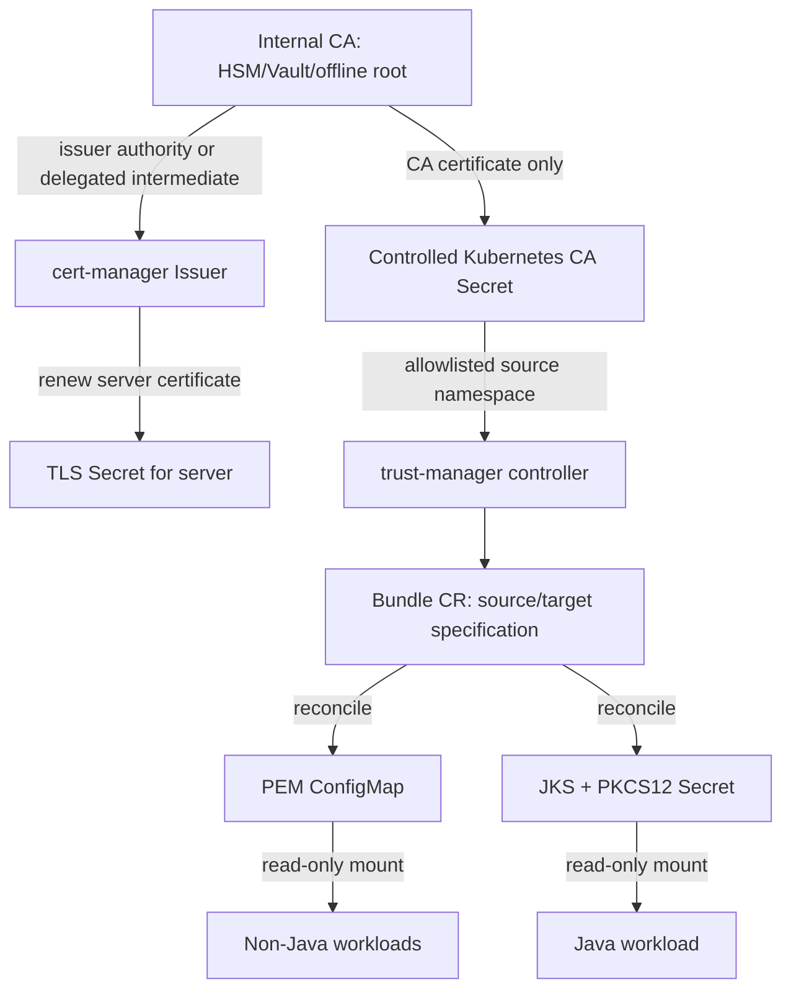
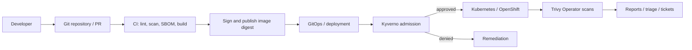

# Architecture and trust boundaries

## PKI and application flow

The root CA **private key must not be distributed** to workloads. In production an HSM/Vault/enterprise PKI should hold signing keys. The lab CA Secret contains a private key only to support a cert-manager CA Issuer example; treat it as a privileged demonstration.

## Software delivery and enforcement

Kyverno validates requests at admission and can generate policy reports for existing resources. Trivy Operator is **asynchronous** and does not itself block admission; use CI gates and admission policy for preventive controls.

## Boundaries and risks

1. **PKI boundary:** restrict signing access; rotate CA with an overlap period and approved change management.
2. **Source boundary:** trust-manager must read only approved Secret sources; use an isolated trust namespace and RBAC.
3. **Target boundary:** label-based namespace selection must be governed (admission policy on who may label namespaces).
4. **Application boundary:** truststore files are mounted read-only; password Secret is separate; JVM TLS clients may need a restart to reload trust.
5. **Supply chain boundary:** CI signatures must be verified against the correct organization identity/key, not merely presence of a signature.
6. **OpenShift boundary:** SCC admission applies in addition to Kyverno and RBAC. Avoid fixed `runAsUser` under restricted-v2.

## Truststore storage decision

Public PEM CA certificates may reside in ConfigMaps. JKS and PKCS12 contain public trust anchors but are password-protected store formats; distribute via Secrets to align with Java credential handling and operational access policies. A truststore password is **not encryption of private keys** when the truststore has no private keys; still keep passwords outside Git and avoid logging them.
